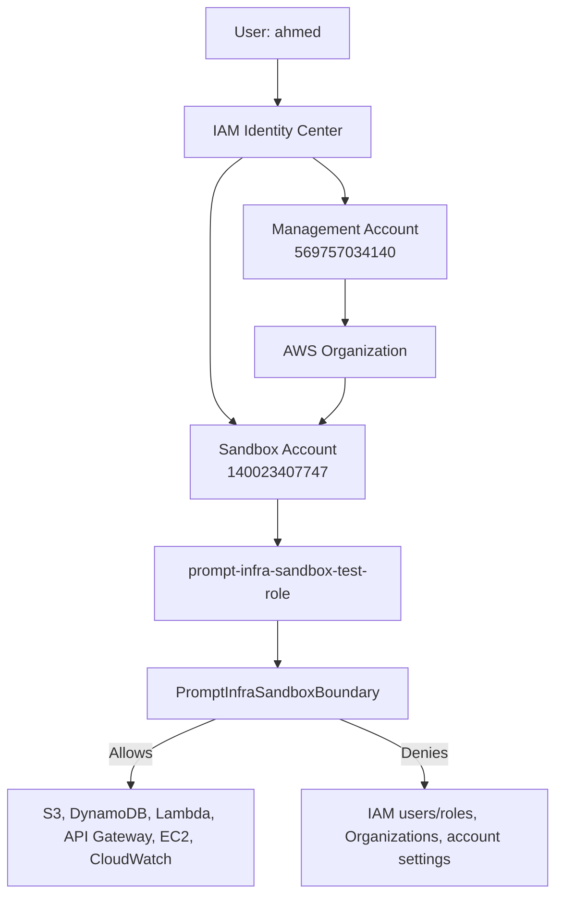

# Account Layout

## Objective

Separate the Prompt-to-Infra control plane from the environment where
generated infrastructure is deployed.

## Accounts

| Account | Account ID | Purpose |
|---|---:|---|
| Management | 569757034140 | IAM Identity Center, platform identity, future control plane |
| Sandbox | 140023407747 | Safe target account for approved infrastructure deployments |

## Access model

- `ahmed` signs in through IAM Identity Center.
- The Identity Center permission set provides administrative access to both accounts.
- `PromptInfraSandboxBoundary` limits the sandbox automation role.
- The boundary denies IAM user/role creation, Organizations changes, and account-management actions.

## Diagram

## Validation

- SSO login works for both accounts.
- The sandbox test role can create allowed infrastructure resources.
- `iam:CreateUser` is explicitly denied by the permissions boundary.
